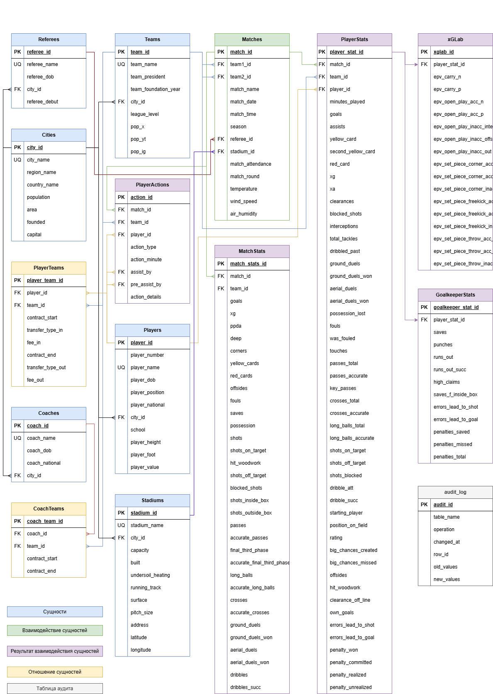
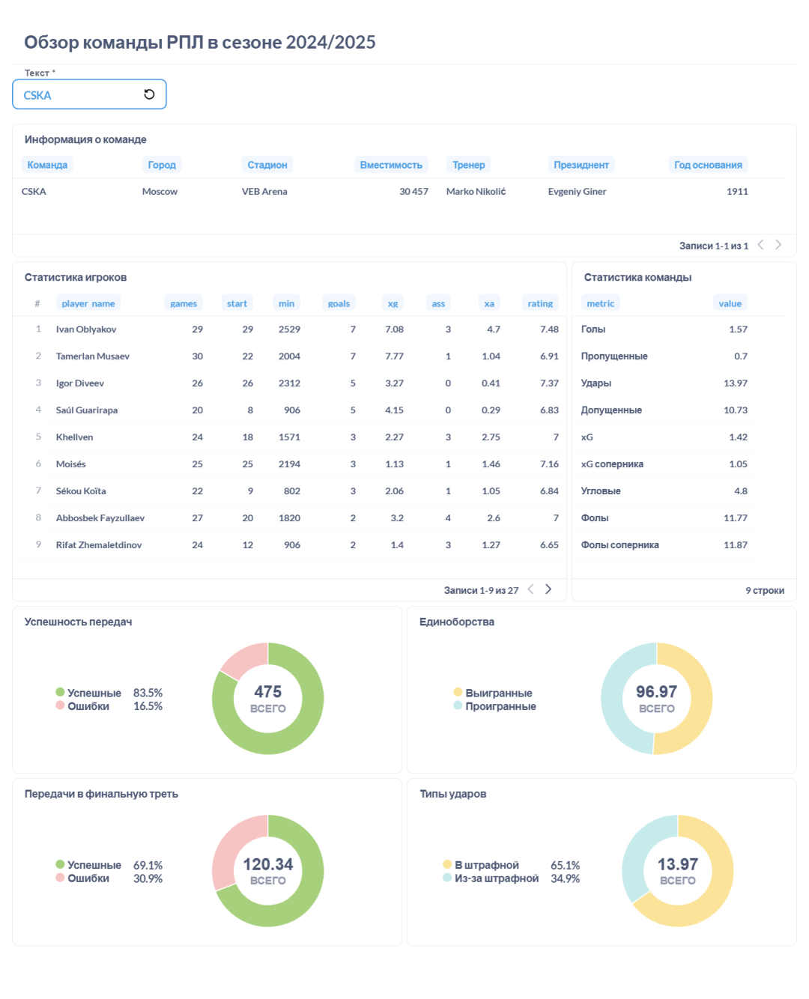
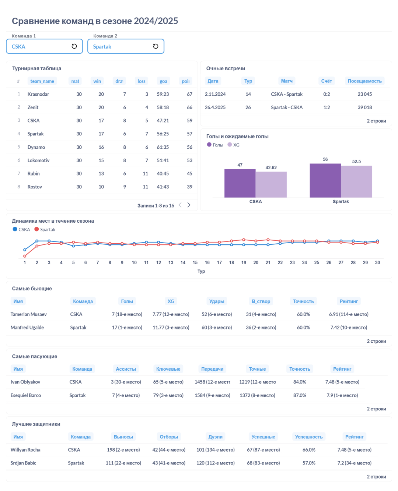

# Football Data Analytics Platform

A personal football data analytics project focused on collecting, processing, storing and analysing football statistics using SQL, SQLite, Python and Metabase.

The project started as an Excel spreadsheet in 2020 and gradually evolved into a relational database and a set of analytical tools for exploring team and player performance.

## Project Overview

The platform brings together football data from multiple sources and stores it in a relational SQLite database. It supports analysis of matches, teams, players, player performance, advanced metrics and historical match information.

The project currently focuses on the Russian Premier League (RPL), with a separate database project for the English Premier League (EPL).

## Key Features

- **Relational database design:** SQLite database with tables for matches, teams, players, player statistics, match statistics and related reference data.
- **SQL analytics:** Analytical queries and views using JOINs, CTEs, window functions, aggregations and subqueries.
- **Database auditing:** SQLite triggers record data changes and maintain an audit history.
- **Data processing:** Python and pandas scripts transform downloaded JSON files into structured Excel files for further validation and database import.
- **Player analysis:** Player performance evaluation, statistical comparisons and radar visualisations.
- **Team and match analysis:** Reports comparing teams and their recent head-to-head performance.
- **Dashboards:** Football statistics visualised in Metabase.

## Technology Stack

| Area | Tools |
|---|---|
| Database | SQLite |
| SQL | JOIN, CTE, Window Functions, Views, Triggers, Aggregations |
| Data processing | Python, pandas |
| Visualisation | Metabase, Matplotlib |
| Data preparation | Microsoft Excel |
| Database management | DB Browser for SQLite |
| Notebooks | Jupyter Notebook, Google Colab |

## Data Processing Workflow

The current workflow combines manual data collection with Python-based processing:

1. Download match and player data in JSON format from the selected data sources.
2. Process and transform JSON files using Python and pandas.
3. Export structured datasets to Excel.
4. Review and prepare the resulting files.
5. Import the prepared data into the SQLite database.
6. Use SQL queries and views to analyse the data.
7. Build reports and visualisations using Metabase and Python.

The data preparation and database loading process is partially manual. Full end-to-end ETL automation is not currently implemented.

## Database

The local SQLite database contains:

- 16 tables
- 22 views
- 39 triggers
- 5 indexes
- More than 65,000 audit log records

The database file itself is not included in this repository. SQL scripts are provided to demonstrate the database structure and implementation.

### Database structure

The SQL scripts are located in `sql/database/`:

- `01_schema.sql` — database tables and relationships
- `02_indexes.sql` — indexes
- `03_views.sql` — analytical and supporting views
- `04_triggers.sql` — audit and data-change triggers

Database schema diagram:



## Analytical Examples

### Team review



### Team comparison



### Player radar


## Repository Structure

```text
football-data-analytics/
│
├── dashboards/
│   ├── team_review.png
│   ├── teams_comparison.png
│   └── two‑player radar.png
│
├── docs/
│   └── images/
│       └── schema.png
│
├── python/
│   ├── json_to_excel.ipynb
│   ├── match_report.ipynb
│   └── radar.ipynb
│
├── sql/
│   ├── analytics/
│   │   └── analytical_queries.sql
│   └── database/
│       ├── 01_schema.sql
│       ├── 02_indexes.sql
│       ├── 03_views.sql
│       └── 04_triggers.sql
│
├── .gitignore
└── README.md
```

## Data Sources

The project uses football statistics and reference information from sources including:

- SofaScore
- Understat
- xGLab
- Transfermarkt

The repository does not contain the full source datasets or the SQLite database. Data availability and permitted use are subject to the respective providers' terms.

## Project Goals

The ongoing development focuses on:

- Improving data quality and consistency.
- Reducing manual steps in the data processing workflow.
- Improving player identification and source ID matching.
- Expanding SQL analytics and statistical reports.
- Developing more interactive dashboards and visualisations.
- Improving database documentation and reproducibility.

## About

This is an independent long-term learning and portfolio project. It demonstrates practical experience in relational database design, SQL analytics, data preparation, data validation and visualisation.
