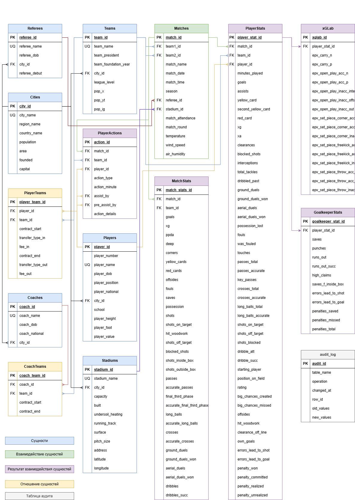
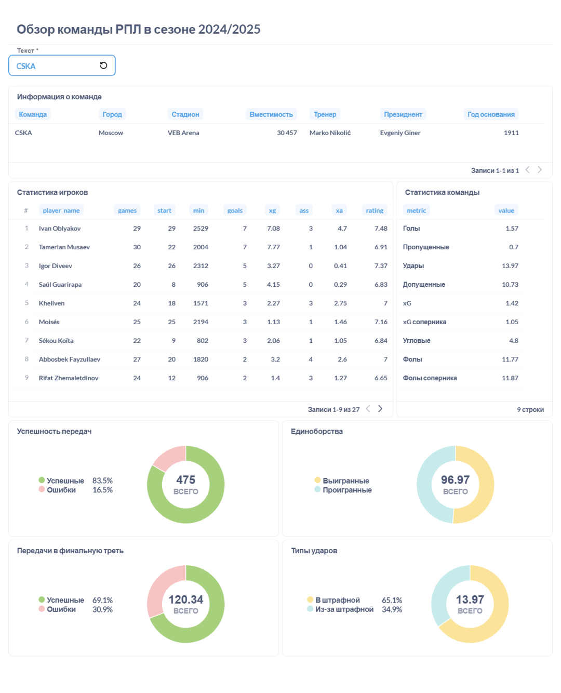
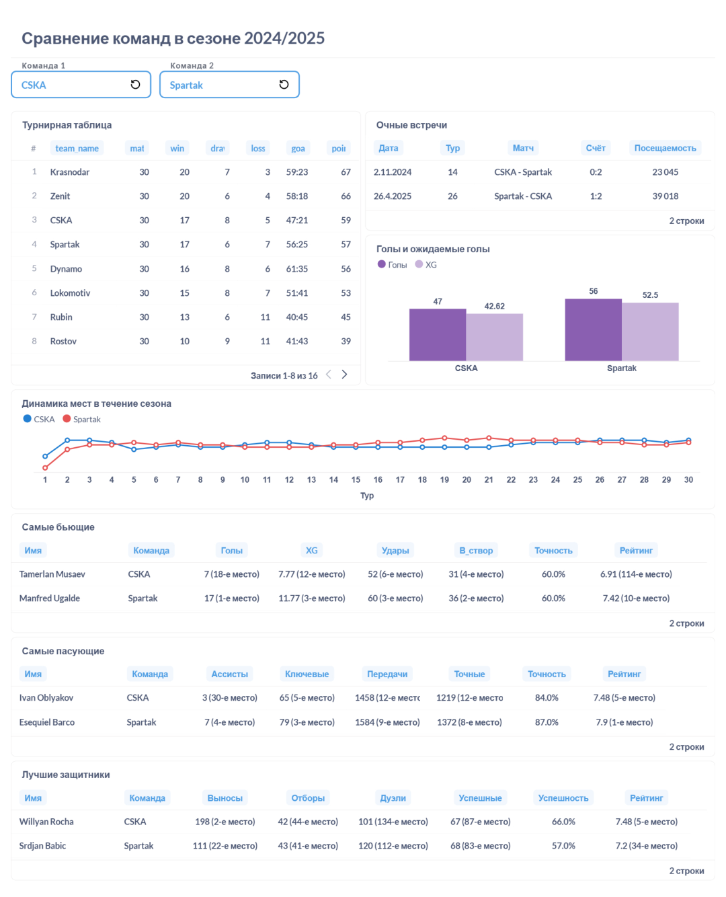

# Football Data Analytics Platform

Персональный проект по сбору, подготовке, хранению и анализу футбольной статистики с использованием **SQL, SQLite, Python, pandas, Excel и Metabase**.

Проект начался в 2020 году с Excel-таблицы для учёта статистики матчей и игроков. Постепенно он вырос в реляционную базу данных и набор аналитических инструментов для изучения результатов команд, индивидуальной статистики футболистов и игровых показателей.

> Это самостоятельный учебно-практический проект и портфолио. Он демонстрирует навыки проектирования реляционной базы данных, SQL-аналитики, подготовки данных и визуализации.

## Содержание

- [О проекте](#о-проекте)
- [Основные возможности](#основные-возможности)
- [Технологии](#технологии)
- [Процесс подготовки данных](#процесс-подготовки-данных)
- [Структура базы данных](#структура-базы-данных)
- [Аналитические отчёты](#аналитические-отчёты)
- [SQL-кейсы](#sql-кейсы)
- [Структура репозитория](#структура-репозитория)
- [Источники данных](#источники-данных)
- [Планы развития](#планы-развития)

## О проекте

Платформа объединяет футбольные данные из нескольких источников и хранит их в реляционной базе SQLite. Проект позволяет анализировать:

- матчи, команды и игроков;
- индивидуальную статистику футболистов;
- командные показатели и результаты;
- ожидаемые голы (xG) и другие продвинутые метрики;
- игровые эпизоды и вклад игроков;
- трансферную историю и связанные справочные данные.

Основное направление — Российская Премьер-Лига (РПЛ). Отдельно ведётся проект по Английской Премьер-Лиге (EPL).

## Основные возможности

- **Реляционная база данных:** таблицы матчей, команд, игроков, статистики игроков и матчей, трансферных и справочных данных.
- **SQL-аналитика:** JOIN, CTE, оконные функции, агрегаты, подзапросы и представления (VIEW).
- **Аудит изменений:** SQLite-триггеры фиксируют операции добавления, изменения и удаления данных в журнале аудита.
- **Подготовка данных:** Python и pandas преобразуют загруженные JSON-файлы в структурированные Excel-таблицы для проверки и последующей загрузки в БД.
- **Анализ игроков:** сравнение результативности и игровых показателей, построение радарных диаграмм.
- **Анализ команд и матчей:** сравнение команд, турнирных показателей и последних очных встреч.
- **Визуализация:** аналитические отчёты и дашборды в Metabase, графики на Python/Matplotlib.

## Технологии

| Направление | Инструменты |
|---|---|
| База данных | SQLite |
| SQL | JOIN, CTE, оконные функции, VIEW, триггеры, агрегаты |
| Обработка данных | Python, pandas |
| Визуализация | Metabase, Matplotlib |
| Подготовка данных | Microsoft Excel |
| Работа с БД | DB Browser for SQLite |
| Среда разработки | Jupyter Notebook, Google Colab |
| Контроль версий | Git, GitHub |

## Процесс подготовки данных

Текущий процесс объединяет ручную загрузку исходных файлов и программную обработку:

1. Скачать JSON-файлы матчей и игроков из выбранных источников.
2. Обработать и преобразовать JSON с помощью Python и pandas.
3. Выгрузить структурированные данные в Excel.
4. Проверить и при необходимости скорректировать подготовленные таблицы.
5. Импортировать подготовленные данные в SQLite.
6. Выполнить SQL-запросы и использовать VIEW для аналитики.
7. Построить отчёты и визуализации в Metabase или Python.

**Важно:** сбор исходных файлов, проверка и импорт в базу пока частично выполняются вручную. Полностью автоматизированный сквозной ETL-процесс ещё не реализован.

## Структура базы данных

Локальная база SQLite содержит:

- **16 таблиц**
- **22 представления (VIEW)**
- **39 триггеров**
- **5 индексов**
- **более 65 000 записей** в журнале аудита

Файл базы данных не включён в репозиторий. Вместо него опубликованы SQL-скрипты, демонстрирующие структуру и логику базы.

Диаграмма структуры:



SQL-скрипты базы находятся в каталоге [sql/database](sql/database/):

| Файл | Назначение |
|---|---|
| [01_schema.sql](sql/database/01_schema.sql) | Создание таблиц и структуры базы данных |
| [02_indexes.sql](sql/database/02_indexes.sql) | Создание индексов для часто используемых полей |
| [03_views.sql](sql/database/03_views.sql) | Представления для аналитики команд, игроков, матчей и тренеров |
| [04_triggers.sql](sql/database/04_triggers.sql) | Триггеры аудита и проверки целостности данных |

## Аналитические отчёты

Отчёты созданы для решения конкретных аналитических задач, а не только для отображения набора цифр.

### 1. Обзор команды — как команда провела сезон?



**На какой вопрос отвечает:** каковы сильные и слабые стороны команды и какие игроки вносят наибольший вклад?

Отчёт объединяет командные и индивидуальные показатели: голы, xG, удары, точность передач, передачи в финальную треть, единоборства и другие игровые метрики.

**Что можно выяснить:** сравнить фактическую результативность с качеством создаваемых моментов, оценить оборонительные показатели и увидеть, насколько эффективно команда использует владение мячом.

### 2. Сравнение команд — в чём различия между двумя клубами?



**На какой вопрос отвечает:** какая из двух команд успешнее и за счёт каких игровых показателей формируется разница?

Отчёт объединяет положение в таблице, очные встречи, голы и xG, изменение позиции по ходу сезона, а также лидеров по атакующим, созидательным и оборонительным метрикам.

**Что можно выяснить:** сравнить итоговый результат с качеством игры, найти сильные стороны каждого клуба и оценить историю очных матчей.

### 3. Радар игроков — чем отличаются футболисты одной позиции?


**На какой вопрос отвечает:** какие игровые качества отличают двух футболистов, выполняющих схожую роль?

Пример сравнивает Wendel и Matvey Kislyak на позиции опорного полузащитника в сезоне 2025/26. Показатели нормализованы на 90 минут. В сравнительную выборку включены игроки соответствующей позиции с заданным минимальным игровым временем и количеством появлений на позиции.

**Что можно выяснить:** увидеть различия в профиле игроков — например, в передачах, продвижении мяча, единоборствах и оборонительных действиях. Радар помогает сравнить профили, но сам по себе не определяет, кто из игроков универсально лучше.

## SQL-кейсы

В каталоге [sql/analytics](sql/analytics/) собраны отдельные примеры аналитических задач. Каждый файл содержит постановку задачи, используемые источники данных, SQL-запросы, описание структуры результата и рекомендации по интерпретации.

| Файл | Аналитическая задача | Основные приёмы |
|---|---|---|
| [01_team_performance.sql](sql/analytics/01_team_performance.sql) | Как команды выступают в чемпионате и насколько эффективны в атаке? | VIEW, CTE, агрегации, расчёт метрик |
| [02_player_performance.sql](sql/analytics/02_player_performance.sql) | Какие игроки показывают лучшие результаты с учётом игрового времени? | VIEW, ранжирование, вычисляемые показатели |
| [03_player_value_epv.sql](sql/analytics/03_player_value_epv.sql) | Какие игроки создают ценность через продвижение мяча, открытые игровые эпизоды и стандарты? | VIEW, показатели на 90 минут, ранжирование |
| [04_game_state_analysis.sql](sql/analytics/04_game_state_analysis.sql) | Какие команды отыгрываются после пропущенного гола и удерживают преимущество? | JOIN, CTE, отношения и агрегаты |
| [05_goal_contribution.sql](sql/analytics/05_goal_contribution.sql) | Какие игроки и связки участвуют в голевых действиях? | VIEW, группировки, доли и проценты |
| [06_transfer_analysis.sql](sql/analytics/06_transfer_analysis.sql) | Какие трансферы и клубы имеют наибольшую зафиксированную стоимость? | Self JOIN, CTE, оконные функции, агрегации |

Запросы рассчитаны на выполнение в SQLite после создания структуры и загрузки необходимых данных. База данных в репозитории не публикуется, поэтому числовые результаты запросов не приводятся без отдельного воспроизведения на актуальной базе.

## Структура репозитория

Подробное описание каждой папки и каждого файла находится в [PROJECT_STRUCTURE.md](PROJECT_STRUCTURE.md).

```text
football-data-analytics/
├── dashboards/       # Скриншоты аналитических отчётов
├── docs/images/      # Схема базы данных
├── python/           # Jupyter/Colab ноутбуки для обработки и анализа
├── sql/analytics/    # SQL-кейсы с аналитическими задачами
├── sql/database/     # DDL: таблицы, индексы, VIEW и триггеры
├── .gitignore        # Исключения для локальных и временных файлов
├── README.md         # Основная документация на английском
├── README_RU.md      # Русская версия документации
└── PROJECT_STRUCTURE.md # Описание структуры и файлов проекта
```

## Источники данных

В проекте используются футбольная статистика и справочная информация из источников:

- SofaScore
- Understat
- xGLab
- Transfermarkt

Полные исходные наборы данных и файл SQLite в репозитории не размещаются. Доступность и допустимое использование данных определяются условиями соответствующих поставщиков.

## Планы развития

- Улучшить контроль качества и согласованность данных.
- Сократить количество ручных операций при подготовке и загрузке данных.
- Улучшить сопоставление игроков по идентификаторам источников.
- Расширить набор SQL-аналитики и статистических отчётов.
- Развивать интерактивные дашборды и визуализации.
- Повысить воспроизводимость и документированность проекта.
